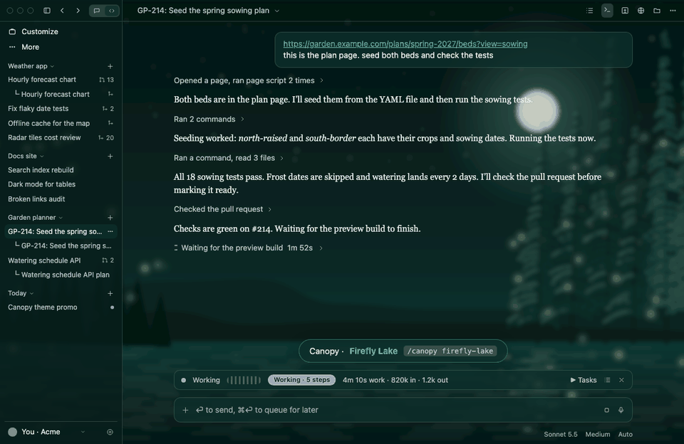
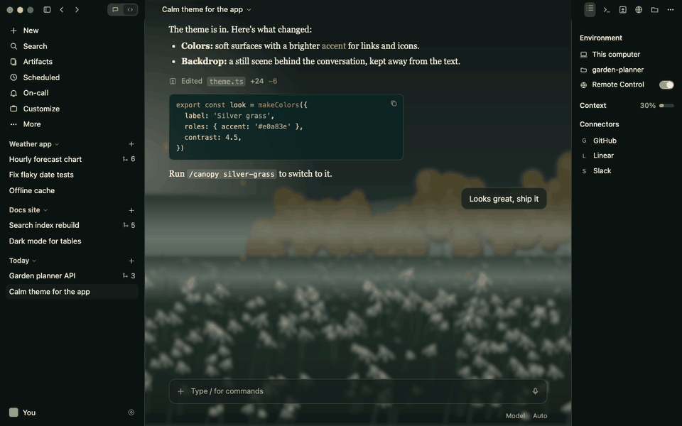
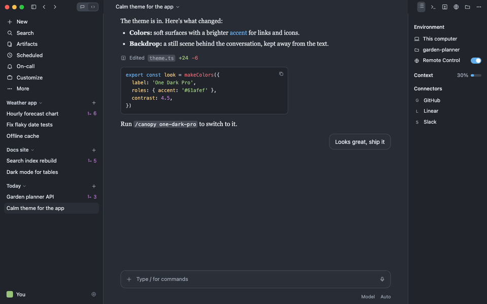
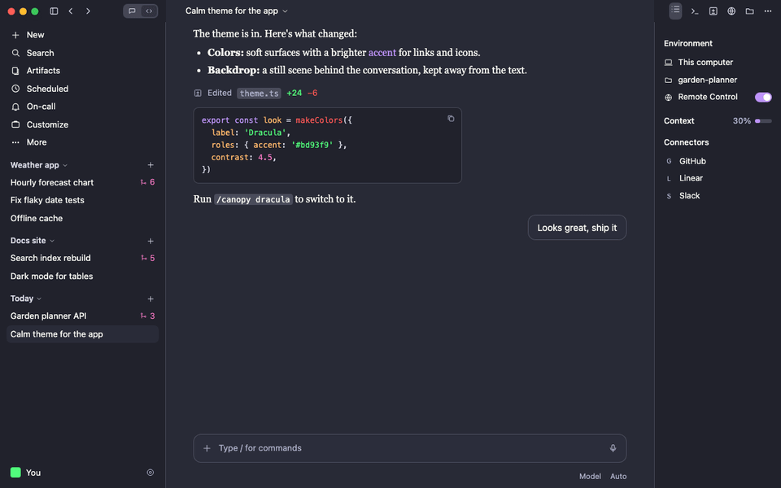
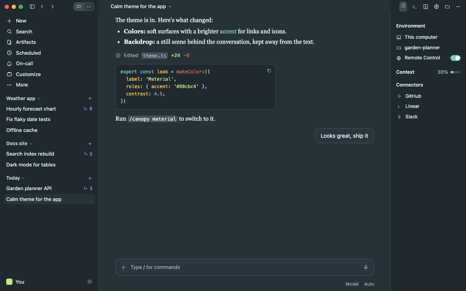

<div align="center">

# Canopy

**Calm, nature-inspired themes for the Claude Code desktop app, plus three VS Code favourites.**

[](https://github.com/mjoyshuvo/canopy-claude-desktop-theme)
[](https://github.com/mjoyshuvo/canopy-claude-desktop-theme/releases)
[](LICENSE)



</div>

## Contents

- [Themes](#themes)
- [Requirements](#requirements)
- [Install](#install)
- [Usage](#usage)
- [Troubleshooting](#troubleshooting)
- [Update and uninstall](#update-and-uninstall)
- [How it works](#how-it-works)
- [Adding a theme](#adding-a-theme)
- [License](#license)

## Themes

| Theme | Mode | Motion | Text tint | Command |
| --- | --- | --- | --- | --- |
| [Firefly Lake](#firefly-lake) | Dark | Animated | Soft teal | `/canopy firefly-lake` |
| [Silver grass](#silver-grass) | Dark | Animated | Warm gold | `/canopy silver-grass` |
| [Apple green](#apple-green) | Light | Still | Deep teal-green | `/canopy apple-green` |
| [One Dark Pro](#vs-code-favourites) | Dark | Still | Sky blue | `/canopy one-dark-pro` |
| [Dracula](#vs-code-favourites) | Dark | Still | Pale lavender | `/canopy dracula` |
| [Material](#vs-code-favourites) | Dark | Still | Aqua | `/canopy material` |

Each theme tints its main text toward its accent colour. The task-list check icons share that colour, so they pick up the tint too. Text keeps 7.5:1 contrast or better on every surface.

### Firefly Lake

A moonlit lake at night. Fireflies drift at the edges, tall spruces sway in slow gusts, the water ripples under the moon, and a quiet firework opens over the trees every few seconds. A light frost, edge to edge, keeps the reading area calm.


### Silver grass

A dense meadow of low silver grass at dusk. Gusts of breeze roll through it from left to right, mist drifts over a still lake, and muted autumn trees sit on the far shore while a few leaves blow past. On the right, a katana leans in the grass with a samurai half-mask hanging from its cord. Frosted edge to edge.



### Apple green

A soft apple-green conversation beside light sidebars, with colorful sidebar icons and warm green code blocks. No motion.


### VS Code favourites

Three of the most-installed VS Code colour themes, on a flat still ground in their own editor colour:

#### One Dark Pro

Slate greys with blue keywords, green strings and purple literals.



#### Dracula

Deep violet-grey with purple, pink and green accents.



#### Material

Material Theme's blue-grey with its teal accent and pastel code.



Each pairs the app's code blocks with the matching highlighting theme where the app offers it. The app's own icons stay as they are: a mod can recolour them through the theme's accent colours, but cannot replace them with another icon set.

> Previews show the theme in a mock-up of the app window. The conversation in them is sample content.

## Requirements

- The **Claude desktop app**, **Code** tab. Themes also paint in the mobile app.
- A Claude Code version that supports mods (themes).
- Themes do not paint in the terminal CLI or in IDE extensions.

## Install

In a Claude Code session in the desktop app:

```
/plugin marketplace add mjoyshuvo/canopy-claude-desktop-theme
/plugin install canopy@canopy
```

Then start a new session, or run `/reload-plugins` in the current one. Canopy applies **Apple green** the first time and shows the **Canopy themes** picker above the message box. It shows by itself only once; `/canopy` brings it back.

## Usage

### Pick a theme

1. Run `/canopy`. The **Canopy themes** picker appears above the message box, listing every theme with its colours.
2. Click a theme. To use the keyboard, click inside the picker first; then the arrow keys and Enter, or a theme's number, pick it.
3. Choose where it applies:
   - **This session only**: the theme applies now. Your saved theme stays as it is, and the next session uses it.
   - **All sessions**: the theme is saved and applied at the start of every session.

Press **Back** to pick a different theme, or **Close** to leave without changing anything.

The picker sits in the main column rather than the side panel. A mod can't move the keyboard there from the message box, which is why the keys work only after a click.

### Commands

| Command | What it does |
| --- | --- |
| `/canopy` | Open the theme picker |
| `/canopy <theme>` | Switch to a theme for all sessions, for example `/canopy dracula` |
| `/canopy <theme> session` | Switch to a theme for this session only, for example `/canopy dracula session` |
| `/canopy off` | Use the app's own look for this session |
| `/canopy debug` | Print diagnostics (for bug reports) |

Theme names: `firefly-lake`, `silver-grass`, `apple-green`, `one-dark-pro`, `dracula`, `material`.

- A session-only theme wins over your saved theme until the session ends. Choosing a theme for all sessions replaces it.
- `off` lasts for the current session only. The next session uses your saved theme.
- Each theme sets its own light or dark mode, whatever the app's appearance setting is.

## Troubleshooting

### The colors change, but there is no backdrop scene

On macOS, **Reduce transparency** hides every theme backdrop. Turn it off:

1. Open **System Settings**.
2. Go to **Accessibility → Display**.
3. Turn off **Reduce transparency**.
4. Switch back to Claude. The scene shows at once; no restart is needed.

To check the setting from a terminal (`1` means on, `0` means off):

```bash
defaults read com.apple.universalaccess reduceTransparency
```

### The scene shows but does not move

- **Reduce motion** stops all animation. On macOS: **System Settings → Accessibility → Display → Reduce motion**.
- Apple green, One Dark Pro, Dracula and Material have no motion by design.

### Nothing changes at all

1. Run `/reload-plugins`, then `/canopy firefly-lake session`.
2. Check that you are in the desktop app's **Code** tab, not the terminal.
3. Run `/canopy debug` and include the output in an [issue](https://github.com/mjoyshuvo/canopy-claude-desktop-theme/issues).

### Some panes keep the app's colors

This is expected. Themes color the conversation area. The **Changes**, **Terminal**, **Files** and browser panes keep the app's own colors.

## Update and uninstall

Update:

```
/plugin marketplace update canopy
```

Then run `/reload-plugins`, or start a new session. Release notes are on the [releases page](https://github.com/mjoyshuvo/canopy-claude-desktop-theme/releases).

Uninstall:

```
/plugin uninstall canopy@canopy
/plugin marketplace remove canopy
```

Run `/canopy off` first if you want the app's look back in the current session.

## How it works

Canopy is a Claude Code **mod**: a plugin whose hooks change the app's interface.

- **Colors**: each theme is built with the design system's color generator, so every surface and text color meets contrast rules. The main text is tinted toward the theme's accent; the generator also derives borders and the task-list icons from it.
- **Session or saved**: an all-sessions choice is kept in Claude Code's plugin store. A session-only choice is kept in the session's own state, which ends with the session.
- **Backdrop**: each animated theme draws an SVG scene behind the conversation, with its own frost across the full width so the sidebars match the middle. Animation is plain CSS, so it runs no scripts and loads nothing from the network.
- **Privacy**: Canopy sends no data anywhere. Your theme choice is stored locally by Claude Code.

```
plugins/canopy/
├── hooks/
│   ├── palettes.ts     colors and scene colors for each theme
│   ├── scene.ts        the SVG backdrops
│   ├── register.tsx    the /canopy command, the theme picker above the prompt and theme switching
│   └── make-colors.js  color generator (vendored, do not edit)
├── types/index.d.ts    the session values the picker keeps
└── tests/              picker and command tests (claude plugin test plugins/canopy)
```

## Adding a theme

1. Add an entry to `PALETTES` in [`palettes.ts`](plugins/canopy/hooks/palettes.ts), with its `id`, `mode`, colors and scene colors.
2. Add its scene to [`scene.ts`](plugins/canopy/hooks/scene.ts) and pick it in `sceneSvg`.
3. Record the preview: `node tools/record.mjs <playwright-path> <frames-dir> <id>` (leave out the id to record every theme; set `CHROME` to a browser binary if Playwright's own is missing), then save it as `media/themes/<id>.gif`.
4. Add a row to the [Themes](#themes) table and a section with its GIF.

Keep scenes under 131,072 characters, animate with CSS only, and keep the art away from the middle of the window, where the text sits.

## License

[MIT](LICENSE) © mjoyshuvo
