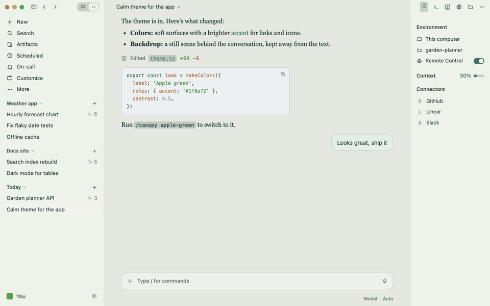
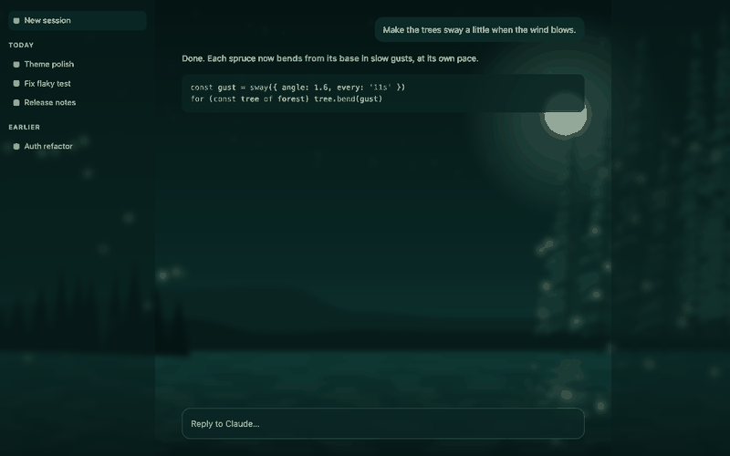
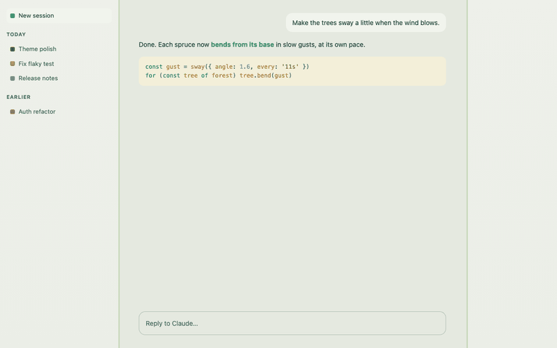

# Canopy

[](https://github.com/mjoyshuvo/canopy)
[](LICENSE)

Two calm looks for the Claude desktop app's Code tab.



## The looks

### Firefly Lake

A moonlit lake at night. Fireflies drift at the edges, tall spruces sway in slow gusts on the right, the water ripples, and a quiet firework opens over the trees every few seconds. A light frost keeps the reading area calm. Dark mode.



### Apple green

A soft apple-green conversation between lighter sage side bands, with colorful sidebar icons and warm green code blocks. No motion. Light mode.



## Install

In Claude Code:

```
/plugin marketplace add mjoyshuvo/canopy
/plugin install canopy@canopy
```

Then start a new session (or run `/reload-plugins`).

## Use

```
/canopy firefly-lake     the night lake
/canopy apple-green      the green day look
/canopy still            colors only, no backdrop
/canopy scene            bring the backdrop back
/canopy off              the app's own look, for this session
```

Your choice is remembered across sessions.

## Notes

- Themes only paint in the desktop and mobile apps, not in the terminal. They color the conversation area; the Changes, Terminal and Files panes keep the app's own colors.
- **Backdrop not showing?** On macOS, turn off *System Settings → Accessibility → Display → Reduce transparency*. It hides every theme backdrop.
- Motion stops when *Reduce motion* is on.

## License

MIT
