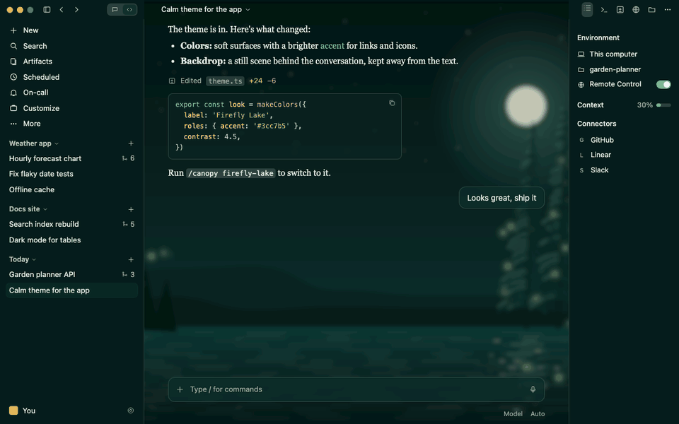
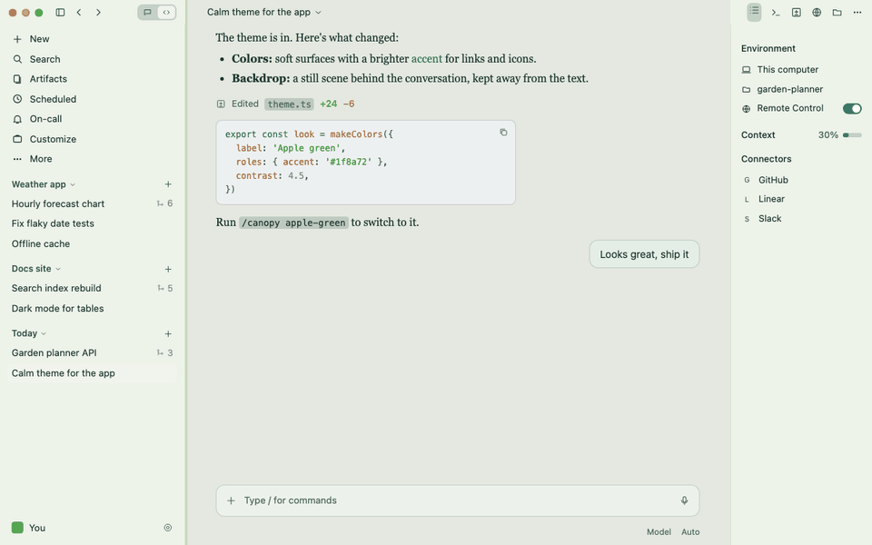

<div align="center">

# Canopy

**Calm, nature-inspired themes for the Claude Code desktop app.**

[](https://github.com/mjoyshuvo/canopy)
[](plugins/canopy/.claude-plugin/plugin.json)
[](LICENSE)


</div>

## Contents

- [Themes](#themes)
- [Requirements](#requirements)
- [Install](#install)
- [Usage](#usage)
- [Troubleshooting](#troubleshooting)
- [Update and uninstall](#update-and-uninstall)
- [How it works](#how-it-works)
- [Adding a theme](#adding-a-theme)
- [License](#license)

## Themes

| Theme | Mode | Motion | Command |
| --- | --- | --- | --- |
| [Firefly Lake](#firefly-lake) | Dark | Animated | `/canopy firefly-lake` |
| [Apple green](#apple-green) | Light | Still | `/canopy apple-green` |

### Firefly Lake

A moonlit lake at night. Fireflies drift at the edges, tall spruces sway in slow gusts, the water ripples under the moon, and a quiet firework opens over the trees every few seconds. A light frost keeps the reading area calm.



### Apple green

A soft apple-green conversation between lighter sage side bands, with colorful sidebar icons and warm green code blocks. No motion.



> Previews show the theme in a mock-up of the app window. The conversation in them is sample content.

## Requirements

- The **Claude desktop app**, **Code** tab. Themes also paint in the mobile app.
- A Claude Code version that supports mods (themes).
- Themes do not paint in the terminal CLI or in IDE extensions.

## Install

In a Claude Code session in the desktop app:

```
/plugin marketplace add mjoyshuvo/canopy
/plugin install canopy@canopy
```

Then start a new session, or run `/reload-plugins` in the current one. Canopy applies **Apple green** the first time.

## Usage

| Command | What it does |
| --- | --- |
| `/canopy firefly-lake` | Switch to Firefly Lake |
| `/canopy apple-green` | Switch to Apple green |
| `/canopy off` | Use the app's own look for this session |
| `/canopy` | Re-apply your saved theme |
| `/canopy debug` | Print diagnostics (for bug reports) |

- Your choice is saved and applied at the start of every session.
- `off` lasts for the current session only. The next session uses your saved theme.
- Each theme sets its own light or dark mode, whatever the app's appearance setting is.

## Troubleshooting

### The colors change, but there is no backdrop scene

On macOS, **Reduce transparency** hides every theme backdrop. Turn it off:

1. Open **System Settings**.
2. Go to **Accessibility → Display**.
3. Turn off **Reduce transparency**.
4. Switch back to Claude. The scene shows at once; no restart is needed.

To check the setting from a terminal (`1` means on, `0` means off):

```bash
defaults read com.apple.universalaccess reduceTransparency
```

### The scene shows but does not move

- **Reduce motion** stops all animation. On macOS: **System Settings → Accessibility → Display → Reduce motion**.
- Apple green has no motion by design.

### Nothing changes at all

1. Run `/reload-plugins`, then `/canopy firefly-lake`.
2. Check that you are in the desktop app's **Code** tab, not the terminal.
3. Run `/canopy debug` and include the output in an [issue](https://github.com/mjoyshuvo/canopy/issues).

### Some panes keep the app's colors

This is expected. Themes color the conversation area. The **Changes**, **Terminal**, **Files** and browser panes keep the app's own colors.

## Update and uninstall

Update:

```
/plugin marketplace update canopy
```

Uninstall:

```
/plugin uninstall canopy@canopy
/plugin marketplace remove canopy
```

Run `/canopy off` first if you want the app's look back in the current session.

## How it works

Canopy is a Claude Code **mod**: a plugin whose hooks change the app's interface.

- **Colors**: each theme is built with the design system's color generator, so every surface and text color meets contrast rules.
- **Backdrop**: each theme draws an SVG scene behind the conversation. Animation is plain CSS, so it runs no scripts and loads nothing from the network.
- **Privacy**: Canopy sends no data anywhere. Your theme choice is stored locally by Claude Code.

```
plugins/canopy/hooks/
├── palettes.ts     colors and scene colors for each theme
├── scene.ts        the SVG backdrops
├── register.tsx    the /canopy command and theme switching
└── make-colors.js  color generator (vendored, do not edit)
```

## Adding a theme

1. Add an entry to `PALETTES` in [`palettes.ts`](plugins/canopy/hooks/palettes.ts), with its `id`, `mode`, colors and scene colors.
2. Add its scene to [`scene.ts`](plugins/canopy/hooks/scene.ts) and pick it in `sceneSvg`.
3. Record the preview: `node tools/record.mjs <playwright-path> <frames-dir>`, then save it as `media/themes/<id>.gif`.
4. Add a row to the [Themes](#themes) table and a section with its GIF.

Keep scenes under 131,072 characters, animate with CSS only, and keep the art away from the middle of the window, where the text sits.

## License

[MIT](LICENSE) © mjoyshuvo
